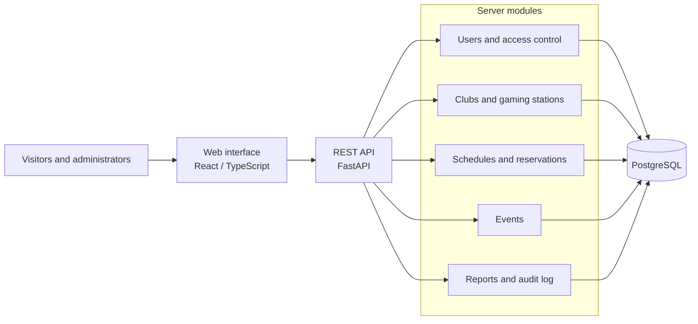

# CyberSeat

## Information System for Managing Gaming Station Reservations in Esports Centres

CyberSeat is a diploma project developed within the **Software Engineering** programme at Astana IT University.

| Item | Details |
|---|---|
| Group | SE-2404 |
| Supervisor | Myrzakerimova Alua |
| Team members | Aibekuly Alibi, Akhmetov Nurali, Mansur Urynbassar |
| Current stage | Analysis, design, and preparation for initial evaluation |

## Project Overview

CyberSeat is a proposed web-based system for finding esports centres, viewing the availability and specifications of gaming stations, and reserving visit intervals. The planned solution includes a visitor-facing interface, an administration panel, a server application, and a shared relational database.

The system is intended for visitors to PC and console gaming clubs, club administrators, and managers responsible for multiple venues.

## Problem Statement and Aim

When reservations are handled through phone calls, messaging applications, and separate spreadsheets, the displayed availability may differ from the actual schedule. Concurrent requests increase the risk of overlapping reservations, while fragmented records make utilisation analysis difficult.

**Project aim:** to design, implement, and evaluate an information system that combines the search for available gaming stations, interval-based reservations, and club management with role-based access control.

The expected practical benefit is a reduction in manual reservation operations and improved schedule consistency. User needs and the suitability of the proposed interaction design will be evaluated through interviews and prototype assessment.

## Scope and Planned Functionality

| User role | Planned capabilities |
|---|---|
| Guest | Browse the club catalogue, gaming-station specifications, and availability |
| Registered visitor | Create and cancel personal reservations, view reservation history, and browse the event calendar |
| Club administrator | Manage stations, schedules, reservations, unavailable intervals, events, and reports for assigned clubs |
| System administrator | Manage clubs and administrator assignments |

### Primary User Flow

**Select a club -> choose a date and time -> select an available station -> confirm the reservation -> view it in the personal account.**

Before confirmation, the server must recheck station availability. If a conflict is detected, the user is asked to select another station or time.

Detailed visitor and administrator scenarios are documented in [User and Administrator Scenarios](docs/requirements/user-scenarios.md).

### Planned User Interface

The principal planned screens are:

- A club catalogue with filters for club, time, and station specifications.
- A club page containing its address, equipment information, working hours, and floor layout.
- Station selection and reservation confirmation.
- A personal account containing active and previous reservations.
- A tournament and event calendar.
- Administrative schedule, station-management, event-management, and reporting screens.

The interface is intended for desktop and mobile devices. Station statuses must be communicated through both text and colour. Forms and data views must provide distinct states for loading, validation errors, empty results, server failures, and connection loss.

## Proposed Architecture

The proposed solution follows a modular-monolith architecture with a separate web client, a server application exposing a REST API, and a relational database.

The server is responsible for business rules, authorisation checks, and transactional operations. PostgreSQL provides data relationships and integrity constraints. The modular structure separates the team's areas of responsibility while preserving a single reservation-processing mechanism.

### Principal Data Entities

The initial domain model includes a user, club, administrator assignment, gaming station, working schedule, unavailable interval, reservation, event, and audit-log entry.

### Key Requirements

- Active reservations for the same station must not overlap, including when requests are submitted concurrently.
- Every reservation must comply with the club's working schedule and unavailable intervals.
- A cancelled reservation must remain in history while releasing the occupied interval.
- A visitor may access only their own reservations.
- A club administrator may access only clubs assigned to them.
- Reservation creation and maintenance blocking must use consistent conflict rules.
- Dates and times must be displayed in the selected club's time zone.

Protection against conflicting reservations is planned at the transaction and database-constraint levels. A preliminary availability check in the user interface is not the sole protection mechanism.

## Proposed Technology Stack

| Component | Technologies |
|---|---|
| Web interface | React, TypeScript, Vite |
| Server application | Python, FastAPI, Pydantic |
| Database | PostgreSQL |
| Data access and migrations | SQLAlchemy, Alembic |
| Server-side testing | Pytest |
| Interface testing | Vitest, Testing Library, Playwright |
| Load testing | k6 |
| Application environment | Docker Compose |
| Version control and task management | GitHub, YouTrack |

The technology choices remain subject to the documented comparison of alternatives and may be refined during the design stage.

## Team Responsibilities

The following table defines the planned individual responsibilities and deliverables.

| Team member | Area of responsibility | Planned deliverables |
|---|---|---|
| Aibekuly Alibi | Database and reservation module | ER diagram, migrations, reservation creation and cancellation API, overlap prevention, integration tests, and load tests |
| Akhmetov Nurali | Administrative server functionality | Roles and permissions, club and schedule management, reporting, and verification of administrative operations |
| Mansur Urynbassar | Visitor and administrator interfaces | UX mockups, application screens, API integration, event-calendar interface, and verification of user scenarios |

Tasks are managed in the shared YouTrack project using the **ECR** prefix. Task identifiers are included in branch names, commit messages, and Pull Request descriptions to connect planned work with repository changes.

## Verification and Evaluation Overview

| Area | Planned method | Evaluation criterion |
|---|---|---|
| Reservation workflow | Integration tests for creation and cancellation | Correct changes to reservation status and station availability |
| Concurrent requests | Simultaneous requests for overlapping intervals at the same station | No more than one confirmed reservation |
| Access control | Requests for owned and unowned resources from different roles | No unauthorised access |
| Reporting | Comparison with a controlled data set | Calculated indicators match expected values |
| Performance | API load testing | Response time, throughput, and error rate measured under a defined workload |
| Interface usability | Users complete representative tasks | Task-success rate, completion time, and number of user errors |

Detailed metrics, test conditions, and baseline comparisons are maintained in the project verification and evaluation plan.

## Development Stages

| Stage | Expected outcome |
|---|---|
| Initial evaluation by October 24, 2026 | Project justification, literature and existing-system reviews, requirements, architectural diagrams, UX prototype, and evaluation plan |
| Application foundation | Data model, migrations, authentication, and the club and station catalogue |
| Minimum viable product | Complete reservation workflow, personal account, initial administration panel, and overlap prevention |
| Diploma-version development | Floor layout, event calendar, reporting, and audit log |
| Final evaluation | Test results, refined interface, complete documentation, and a demonstrable system |

Online payments, a loyalty programme, and hardware management are outside the mandatory project scope.

## Setup and Local Execution

The project is currently in the analysis and design stage. The following section describes the planned local environment. Exact versions, commands, service addresses, and test instructions will be added after the first runnable prototype has been verified.

### Planned Environment

The primary execution method is planned to use Git, Docker, and Docker Compose. The environment will include the web client, server application, and PostgreSQL.

Development without containers will require compatible versions of Python, Node.js, and PostgreSQL, which will be specified in the dependency files.

### Planned Configuration

- Database connection parameters and application settings will be documented in `.env.example`.
- Local values will be stored in `.env`, which must be excluded from version control.
- The database schema will be created and updated through Alembic migrations.
- A separate demonstration data set will include sample clubs, stations, and users with different roles.

### Planned Prototype Execution

1. Clone the repository.
2. Prepare the local configuration using `.env.example`.
3. Start PostgreSQL and apply the migrations.
4. Load the demonstration data.
5. Start the server application and web interface.
6. Verify the search, reservation creation, and reservation cancellation flow.

Verified commands, interface and API addresses, and test instructions will be added with the first working prototype.

## Project Resources

- [Main GitHub repository](./)
- [YouTrack Agile board](https://nerybr.youtrack.cloud/agiles/204-1/current)
- [User and Administrator Scenarios](docs/requirements/user-scenarios.md)
- [Alibi's October 24 deliverables](docs/report/alibi-deliverables.md): proposal, critical literature review, technology comparison, booking requirements and architectural diagrams. Prepared for team review.

## Planned Repository Structure

| Directory | Purpose |
|---|---|
| `backend/` | Server application, migrations, and server-side tests |
| `frontend/` | Visitor and administrator web interfaces |
| `tests/` | End-to-end and load-testing materials |
| `docs/requirements/` | Requirements and acceptance criteria |
| `docs/research/` | Literature review and comparison of existing systems |
| `docs/diagrams/` | Architectural diagrams and ER diagram |
| `docs/ux/` | UX mockups and prototype materials |
| `docs/testing/` | Verification plan and test results |
| `docs/report/` | Initial-evaluation and pre-defence reports |

## Current Limitations

The repository currently contains analysis, design, and planning materials. A complete application, final test results, and confirmed execution instructions are not yet available. These outputs will be added progressively during the implementation and evaluation stages.
