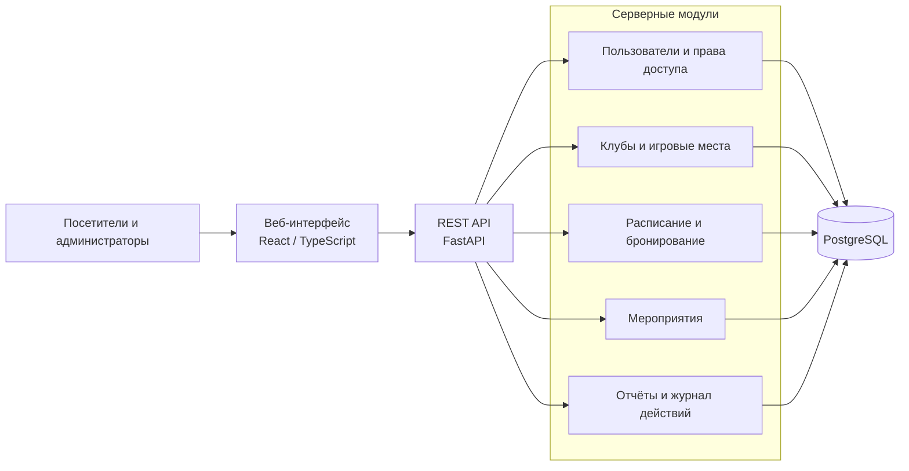

# CyberSeat

## Информационная система управления бронированием игровых мест в киберспортивных центрах

Дипломный проект по образовательной программе **Software Engineering**, Astana IT University.

| Сведения | Значение |
|---|---|
| Группа | SE-2404 |
| Научный руководитель | Мырзакерімова Алуа Бауыржанқызы |
| Участники | Айбекұлы Әліби, Ахметов Нурали Канатович, Урынбасар Мансұр Мұхтарұлы |
| Этап проекта | Проектирование и подготовка к апробации |

## О проекте

CyberSeat - проект веб-системы для поиска киберспортивных центров, просмотра доступных игровых мест и бронирования времени посещения. Предусматриваются пользовательский интерфейс, административная панель и единая база данных.

Система ориентирована на посетителей компьютерных и консольных клубов, администраторов и управляющих несколькими площадками.

## Проблема и цель

При обработке заявок через звонки, переписку и отдельные таблицы информация о доступности мест может расходиться с фактическим расписанием. Параллельные обращения создают риск пересекающихся бронирований, а разрозненный учёт затрудняет анализ загрузки.

**Цель проекта** - разработать и проверить информационную систему, объединяющую поиск доступных мест, бронирование временных интервалов и управление клубами с разграничением прав доступа.

Практическая значимость проекта заключается в сокращении ручных операций при оформлении брони и обеспечении согласованности расписания. Потребности пользователей и применимость предлагаемых решений планируется проверить интервью и оценкой прототипа.

## Планируемая функциональность

| Пользователь | Возможности |
|---|---|
| Гость | Просмотр каталога клубов, характеристик игровых мест и доступности |
| Посетитель | Создание и отмена собственных бронирований, просмотр истории и календаря мероприятий |
| Администратор клуба | Управление местами, расписанием и бронированиями своего клуба; блокировка интервалов; просмотр отчётов |
| Суперадминистратор | Управление клубами и назначение администраторов |

### Основной пользовательский сценарий

**Выбор клуба → дата и время → свободное место → подтверждение бронирования → просмотр в личном кабинете.**

Перед подтверждением система должна повторно проверять доступность места. При конфликте пользователю предлагается изменить место или время.

### Пользовательский интерфейс

Планируются следующие основные экраны:

- Каталог с фильтрами по клубу, времени и характеристикам мест.
- Страница клуба с адресом, оборудованием и схемой зала.
- Выбор места и подтверждение бронирования.
- Личный кабинет с активными и прошлыми бронированиями.
- Календарь турниров и мероприятий.
- Административное расписание и отчёты.

Интерфейс проектируется для компьютеров и мобильных устройств. Статусы мест должны обозначаться текстом и цветом; формы должны учитывать ошибки, загрузку и отсутствие доступных вариантов.

## Архитектура

Предлагается архитектура модульного монолита: отдельный веб-клиент, серверное приложение с REST API и реляционная база данных.

Сервер отвечает за бизнес-правила, проверку доступа и выполнение транзакций. База данных обеспечивает связи и ограничения целостности. Модульная структура позволяет разделить работу участников и сохранить единый механизм обработки бронирований.

### Основные сущности данных

Пользователь, клуб, назначение администратора, игровое место, рабочее расписание, интервал недоступности, бронирование, мероприятие и запись журнала действий.

### Ключевые требования

- Отсутствие пересекающихся действующих броней одного места, включая одновременные запросы.
- Соответствие бронирования рабочему расписанию и ограничениям доступности.
- Сохранение истории отменённых броней с освобождением занятого интервала.
- Доступ посетителя только к собственным бронированиям.
- Доступ администратора только к закреплённым за ним клубам.
- Согласованная обработка бронирований и блокировок мест на обслуживание.
- Учёт часового пояса клуба при отображении даты и времени.

Защита от конфликтующих бронирований предусматривается на уровне транзакций и ограничений PostgreSQL. Предварительная проверка доступности в интерфейсе не является единственным механизмом защиты.

## Планируемый технологический стек

| Компонент | Технологии |
|---|---|
| Пользовательский интерфейс | React, TypeScript, Vite |
| Серверная часть | Python, FastAPI, Pydantic |
| База данных | PostgreSQL |
| Доступ к данным и миграции | SQLAlchemy, Alembic |
| Проверка серверной части | Pytest |
| Проверка интерфейса | Vitest, Testing Library, Playwright |
| Нагрузочные испытания | k6 |
| Окружение приложения | Docker Compose |
| Контроль версий и управление задачами | GitLab, YouTrack |

## Индивидуальный вклад участников

В таблице приведено распределение ответственности и планируемых результатов.

| Участник | Зона ответственности | Результаты работы |
|---|---|---|
| Айбекұлы Әліби | База данных и модуль бронирования | ER-диаграмма, миграции, API создания и отмены бронирований, защита от пересечений, интеграционные и нагрузочные тесты |
| Ахметов Нурали Канатович | Административная серверная часть | Роли и права доступа, управление клубами и расписанием, отчётность, проверки административных операций |
| Урынбасар Мансұр Мұхтарұлы | Пользовательский и административный интерфейсы | Макеты и экраны приложения, интеграция с API, интерфейс календаря мероприятий, проверки пользовательских сценариев |

Задачи ведутся в общем проекте YouTrack с префиксом **ECR**. Номера задач используются в названиях веток и Merge Request для связи запланированных работ с изменениями в репозитории.

## План оценки результатов

| Направление | Способ проверки | Критерий |
|---|---|---|
| Бронирование | Интеграционные тесты создания и отмены | Корректное изменение статуса и доступности |
| Конкурентные запросы | Одновременное бронирование одного места на пересекающиеся интервалы | Не более одной подтверждённой брони |
| Разграничение доступа | Запросы к собственным и чужим данным от разных ролей | Отсутствие несанкционированного доступа |
| Отчётность | Сравнение с контрольным набором данных | Совпадение рассчитанных показателей с ожидаемыми |
| Производительность | Нагрузочные испытания API | Измерение времени ответа, пропускной способности и доли ошибок при заданной нагрузке |
| Удобство интерфейса | Выполнение типовых заданий пользователями | Измерение успешности, времени выполнения и числа ошибок |

## Этапы реализации

| Этап | Основной результат |
|---|---|
| Апробация, до 24 октября 2026 года | Обоснование проекта, обзор литературы и аналогов, требования, архитектурные схемы, UX-прототип и план проверки |
| Основа приложения | Модель данных, миграции, аутентификация, каталог клубов и мест |
| MVP | Полный цикл бронирования, личный кабинет, минимальная административная панель и защита от пересечений |
| Развитие дипломной версии | Схема зала, календарь мероприятий, отчёты и журнал действий |
| Итоговая проверка | Результаты испытаний, доработанный интерфейс, документация и демонстрационная версия |

Онлайн-оплата, программа лояльности и управление оборудованием не входят в обязательный объём текущего проекта.

## Настройка и локальный запуск

Проект находится на этапе проектирования. Ниже приведён план локального окружения; точные версии, команды и адреса сервисов будут зафиксированы после проверки первого работающего прототипа.

### Окружение

Для основного варианта запуска планируются Git, Docker и Docker Compose. В состав окружения войдут веб-клиент, серверное приложение и PostgreSQL.

Для разработки вне контейнеров потребуются Python, Node.js и PostgreSQL совместимых версий, указанных в файлах зависимостей проекта.

### Настройка

- Параметры подключения к базе данных и настройки приложения будут описаны в `.env.example`.
- Локальные значения будут храниться в `.env`, исключённом из системы контроля версий.
- Схема базы данных будет создаваться и обновляться миграциями Alembic.
- Для демонстрации планируется отдельный набор тестовых клубов, мест и пользователей с разными ролями.

### Порядок запуска прототипа

1. Получить исходный код из репозитория.
2. Подготовить локальную конфигурацию по `.env.example`.
3. Запустить PostgreSQL и применить миграции.
4. Загрузить демонстрационные данные.
5. Запустить серверную часть и веб-интерфейс.
6. Проверить сценарий поиска, создания и отмены бронирования.

Проверенная инструкция с командами запуска, адресами интерфейса и API, а также порядком запуска тестов будет добавлена вместе с первым прототипом.

## Материалы проекта

- [Основной репозиторий GitLab](https://gitlab.com/astana-it-university-group3/cyberseat-booking-system).
- Общий проект YouTrack: ECR; https://nerybr.youtrack.cloud/agiles/204-1/current.

Планируемое размещение материалов в репозитории:

| Каталог | Содержание |
|---|---|
| `backend/` | Серверная часть, миграции и серверные тесты |
| `frontend/` | Пользовательский и административный интерфейсы |
| `tests/` | Сквозные и нагрузочные испытания |
| `docs/requirements/` | Требования и критерии приёмки |
| `docs/research/` | Обзор литературы и сравнение аналогов |
| `docs/diagrams/` | Архитектурные схемы и ER-диаграмма |
| `docs/ux/` | Макеты интерфейса |
| `docs/testing/` | План и результаты испытаний |
| `docs/report/` | Отчёт к апробационному периоду |
