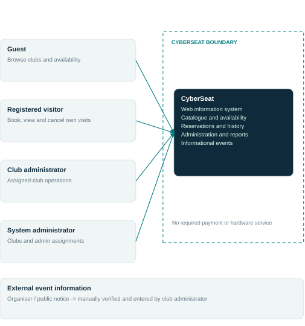
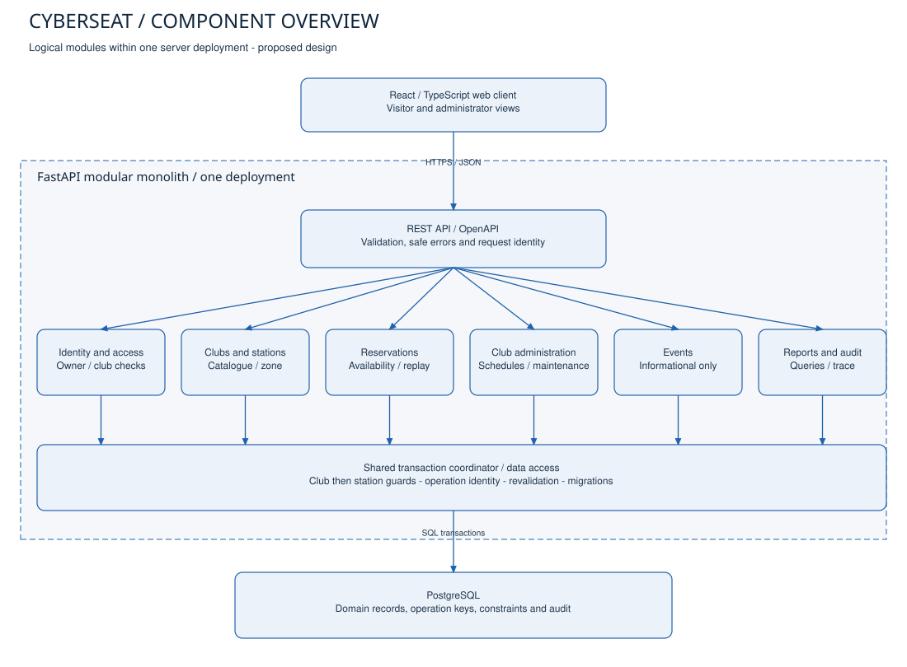

# CyberSeat - System Context and Component Architecture

Version 1.1 | October 23, 2026 | Owner: Aibekuly Alibi | [ECR-10](https://nerybr.youtrack.cloud/issue/ECR-10)

Status: proposed architecture; team agreement confirmed by Alibi on October 23, 2026. These are design views, not deployed services. Detailed ER design is a later ECR-12 deliverable.

## 1. Views and editable sources

| View | Editable source | Readable export | Purpose |
|---|---|---|---|
| System context | [system-context.mmd](system-context.mmd) | [system-context.svg](system-context.svg) | People outside the CyberSeat boundary and their interactions |
| Component overview | [components.mmd](components.mmd) | [components.svg](components.svg) | Web client, API boundary, logical modules and PostgreSQL |

Mermaid sources and SVG exports express the same nodes and relationships. SVG labels are editable text. The component view deliberately includes client and storage context; it is a practical component overview rather than a claim of strict UML notation. Solid arrows denote user requests or runtime calls; the dashed event-source arrow denotes manual information entry. A module is a logical responsibility inside one server deployment, not an independently deployed microservice.

## 2. System context

Guests browse clubs and availability. Registered visitors also create, view and cancel only their own reservations. Club administrators manage stations, working hours, maintenance, bookings, published events and reports within assigned clubs. System administrators manage clubs and assignments. A multi-club manager is represented through assignments rather than unrestricted access by default.

An organiser or public event notice is an information source outside the system. Administrators manually verify and enter event details; there is no required external-feed API. Hosting, the browser and the database are not additional business actors. GitHub and YouTrack manage development and are not runtime dependencies of the reservation workflow. Payment providers and hardware agents are absent because those capabilities are excluded.

## 3. Component overview

| Component | Responsibility and data | Requirement / scenario trace |
|---|---|---|
| React/TypeScript web client | Catalogue, selected interval, reservation forms, own history, calendar and assigned-club admin views; transient loading/error states | BR-01/11/13/14; SC-01 through SC-06; common states |
| REST API boundary / FastAPI | Request models, route contracts, safe errors, authenticated context, correlation/operation IDs; no trust in client owner or role | BR-02/03/06/07; SC-03; common states |
| Identity and access | User/session identity, visitor ownership and current club assignments; checked for every operation | BR-07/08, NFR-02; SC-07/14 |
| Club and station catalogue | Clubs, station identity/specifications, active status and club zone | BR-01/02/14; SC-01/02/08 |
| Reservation and availability | Availability calculation, creation, own history, cancellation and durable replay semantics | BR-03 through BR-12; SC-02 through SC-05 |
| Club administration | Authorised station, schedule and maintenance changes; all booking-affecting writes use the same coordinator | BR-09/10; SC-07 through SC-10 |
| Events | Draft/published/cancelled event information, source, zone and club association; no automatic reservation | SC-06/13 |
| Reporting and audit | Defined scheduled-utilisation queries and actor/action/result records | BR-15, NFR-10; SC-12 |
| Transaction coordinator / data access | Shared lock order, revalidation, operation uniqueness, transaction and error mapping, migrations | BR-04/06/09/10, NFR-01/03/05 |
| PostgreSQL | Durable users, assignments, clubs, stations, schedules, maintenance, reservations, operation identities, events and audit data | All persisted invariants; future ECR-12 schema |

The API invokes identity/access and the applicable domain module. Modules use the shared data-access layer; administration must not implement an independent unsafe booking writer. Reporting reads committed data and never changes reservation status. Audit writes for successful mutations share the business transaction; logging a rejected request is a separate operational event and must not turn a rejection into a committed booking.

## 4. Transaction protocol (proposed implementation contract)

Database baseline: PostgreSQL `READ COMMITTED` with explicit guard locks and a reservation overlap constraint. This is a design to validate during implementation. All steps below belong to one transaction; reads that decide a write happen after the necessary guards are acquired. A process-local mutex cannot protect independent API workers.

1. Authenticate the actor. For creation, claim a unique `(owner_id, operation_key)` record and check its normalised payload fingerprint. A concurrent same-key request waits for the first transaction and then reuses its result. A different payload with the same key is a conflict. The successful operation mapping and reservation commit together.
2. Acquire the club guard row `FOR SHARE` for a station-level operation. Working-hours, club-zone or club-status writers acquire the same guard `FOR UPDATE`. Club configuration writers therefore conflict with in-progress station operations; ordinary reservations at different stations may proceed concurrently.
3. Acquire the station guard row `FOR UPDATE`. Reservation creation, cancellation, maintenance and station-status changes use this same guard. For any batch operation, acquire clubs and stations in ascending ID order; never acquire the club guard after a station guard.
4. Recheck actor/assignment, club and station state, server time, working-hours containment, overlapping confirmed reservations and maintenance. Assignment changes must also coordinate with the relevant authorisation guard or club guard; checking an assignment before waiting for locks is not sufficient for revocation-sensitive writes.
5. Insert or update the reservation and audit record. The database additionally rejects overlapping confirmed `tstzrange` intervals for the same station through a GiST exclusion constraint. Cancellation removes that reservation from active occupancy but preserves its history and operation mapping.
6. Commit before returning success. Map a known interval conflict to a stable 409 domain error. On deadlock/serialization failure, retry the complete transaction within NFR-05 bounds; on exhaustion or timeout return an explicit retryable error. Never retry a known business conflict as if it were a transient fault.

For a club schedule update, the writer takes the exclusive club guard, checks all affected confirmed future bookings and rejects a change that would invalidate them. No implicit cancellation occurs. If stations in several clubs are ever changed together, take all club guards before station guards in the universal order. Club-zone changes with future bookings require explicit migration policy or rejection; silent reinterpretation of instants is prohibited.

The overlap constraint protects reservations in one table. Maintenance in another table is safe only because all applicable writers take the same guards and revalidate; the constraint is not described as enforcing a cross-table invariant. Direct manual DB writes bypassing the protocol are outside authorised application operations and must be restricted operationally. An alternative future design could unify occupancy records or use serialisable transactions, but requires its own proof and tests.

## 5. Runtime flows and failure boundaries

**Create:** browser requests availability -> API returns advisory state -> visitor confirms with an operation key -> access check and transaction protocol -> commit -> response with reservation ID. If another writer wins the station interval, the loser gets a conflict and refreshes availability. After a lost response the browser refreshes its own reservation list and reconciles using the same key rather than inventing a second operation.

**Cancel:** browser requests cancellation -> server verifies owner under the shared protocol -> confirmed future reservation becomes cancelled -> commit -> refreshed own history. A second cancellation returns the cancelled state. Maintenance occupancy remains independent.

**Maintenance:** assigned administrator requests a block -> server checks club assignment and takes guards -> conflict check against confirmed bookings -> commit only if safe. A race with reservation creation has one order, so the second writer observes the first.

**Read/report:** apply access filters on the server -> query committed records -> return selected fields. A station's operational availability and report denominator need defined schedule/maintenance rules. A past reservation proves planned time, not attendance. Bulk reporting should use a defined snapshot when several queries contribute to one result.

The browser is untrusted; it has no database credentials and cannot commit directly. Only the API reaches PostgreSQL. TLS, secrets, session handling and resource access are implementation concerns to verify, not proven properties of these diagrams. No external payment, event feed or notification service can prevent core booking operation because none is mandatory in this scope.

## 6. Consistency and review checklist

- Roles and informational-calendar semantics match ECR-1 and the current README.
- Components use FastAPI, PostgreSQL and REST proposed in ECR-6.
- BR-04/09/10 map to one common transaction coordinator.
- BR-06/11 map to durable operation identity and network-outcome reconciliation.
- NFR-02 maps to resource/club checks in the API and domain operations.
- Sources and exports are provided for both required views; ER details remain in ECR-12.

Required human review: Mansur for client/API boundaries and failure states; Nurali for administrative writes, assignments and reporting. Alibi confirmed his teammates' agreement with the prepared architecture in the working chat on October 23, 2026. The diagrams do not replace Mansur's separate ECR-11 use-case diagram.
